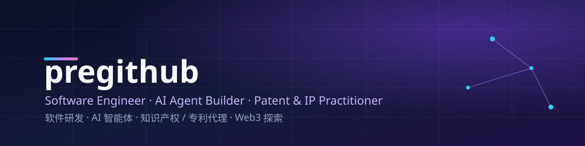

  

  

  

    
    
    
    
  

  

---

### 👨‍💻 About Me / 关于我

- 💻 **14+ 年**软件开发经验，**8 年** AI 专利与知识产权相关工作。
- 🤖 正在用 **LangGraph / LangChain** 构建 AI 智能体、Web 门户与配套工具。
- 🧠 持续探索 **Web3 / 链游** 开发方向。
- 📜 资质：专利代理师 · 人工智能训练师（三级 / 高级工）。
- 📍 坐标成都 · UTC+8。
- 🌱 当前学习：Web3、链上游戏机制、Agent 部署与效果评估。

---

### 🛠️ Tech Stack / 技术栈

  <code>语言 / Languages</code>

  

  <code>框架 / Frameworks & Tools</code>

  

---

### 📊 GitHub Stats / 数据看板

  
  

   

  

   

  

---

### 🚀 Featured Projects / 代表项目

  
  
  

> 💡 可在仓库列表中把想展示的项目 **Pin to profile**：仓库页 → 右上角 ☘️/Pinned → 选择仓库置顶。

---

### 🤝 Open to / 合作方向

- AI Agent / 智能体应用开发与落地
- 专利检索（FTO）、专利撰写与知识产权咨询
- Web3 / 链游相关远程协作

📮 联系我：把上方【】里的占位内容换成你的真实邮箱与社交链接即可。

---

  <i>“Stay hungry, stay foolish.”</i>

